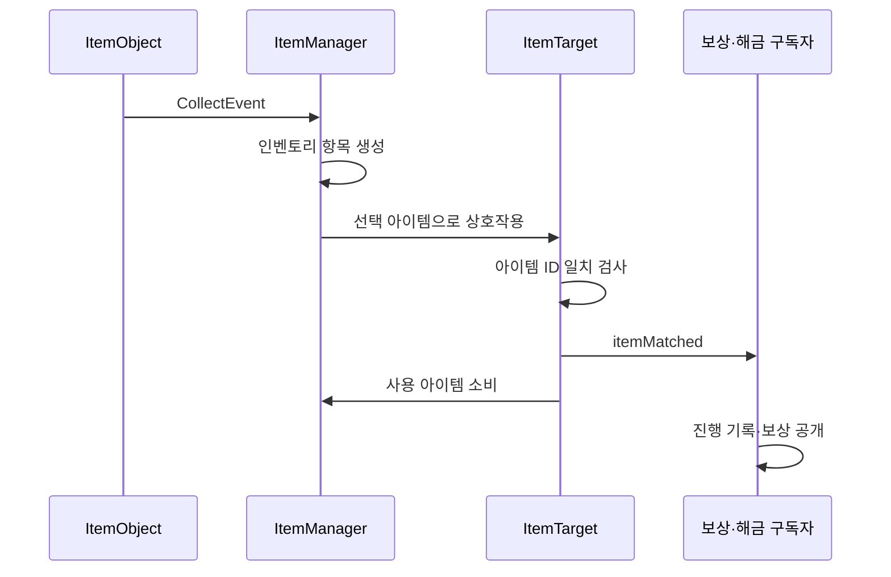

# 아이템과 오브젝트 상호작용

**담당자:** 최성원 — 아이템 데이터·인벤토리·사용 대상·보상·해금 연동

## 코드



**ItemData · ItemObject · ItemManager:** 아이템 정의와 습득·인벤토리를 연결합니다. **ItemTarget:** ID로 사용 대상을 판정합니다. **NoteManager · InteractiveObject:** 아이템 사용의 결과를 보상과 오브젝트 해금으로 연결합니다.

```csharp
[CreateAssetMenu(menuName = "Items/ItemData")]
public class ItemData : ScriptableObject
{
    public Item.Items id;
    public Sprite sprite;
    public float targetScale = 1f;
}

// ItemObject.Collect: 월드 오브젝트가 습득 상태와 이벤트만 전달
public void Collect()
{
    if (data.id != Item.Items.FilledBottle && ItemManager.Instance.IsHolding)
        return;

    ItemManager.Instance.SetCollected(data.id);
    CollectEvent?.Invoke(data, transform.position);
    Destroy(gameObject);
}

// ItemManager: 습득 이벤트 구독과 인벤토리 표시 연결
private void Start() => ItemObject.CollectEvent += AddItem;
private void OnDestroy() => ItemObject.CollectEvent -= AddItem;

private void AddItem(ItemData data, Vector3 startPosition)
{
    var entry = Instantiate(inventoryItemPrefab, targetGroup)
        .GetComponent<InventoryItem>();
    entry.Data = data;
    inventoryItems.Add(entry);
}
```

```csharp
// ItemManager.Update의 월드 오브젝트 분기: 클릭 위치에서 사용 대상 탐색
private void UseSelectedItem()
{
    if (!IsHolding || !GameManager.Instance.IsPlaying) return;

    var ray = Camera.main.ScreenPointToRay(Input.mousePosition);
    if (Physics.Raycast(ray, out var hit))
    {
        var target = hit.collider.GetComponent<ItemTarget>();
        if (target != null) target.OnInteract(SelectedItem.Data);
    }
    IsHolding = false;
}

// ItemTarget.OnInteract: 올바른 아이템만 적용하고 인벤토리에서 소비
public bool OnInteract(ItemData data)
{
    if (id != data.id) return false;
    // 아이템 ID가 맞는 대상만 효과를 실행하고, 성공한 사용에만 소비를 연결한다.
    itemMatched();
    ItemManager.Instance.RemoveItem();
    return true;
}
```

```csharp
// NoteManager: 글자 조각을 완성하면 해당 오브젝트의 해금 이벤트 전달
public void OnInsertLetter(int type, int id)
{
    LetterInserted[id] = true;
    ++CompletedLetterCount[type];
    if (CompletedLetterCount[type] >= LetterCountGoal[type])
        BlurrUnlockEvent?.Invoke((Item.Interactives)type);
}

// InteractiveObject: 자기 타입의 해금만 반영
private void UnlockBlurr(Item.Interactives unlocked)
{
    // 같은 이벤트를 여러 오브젝트가 받아도 자기 종류의 해금만 처리한다.
    if (unlocked != typeId) return;
    GetComponentInChildren<ParticleSystem>(true).gameObject.SetActive(false);
    GetComponent<Button>().interactable = true;
}

// 미니게임 완료가 확인되면 진행 상태를 기록하고 보상 아이템 공개
private void GiveRewards(Item.Interactives completed)
{
    if (completed != typeId) return;
    GameManager.Instance.SetMiniGameClear(typeId.ToString());
    foreach (var item in GetComponentsInChildren<ItemObject>(true))
        item.gameObject.SetActive(true);
    // 보상을 준 뒤 구독을 끊어 이후 완료 이벤트에서 다시 지급하지 않는다.
    TVManager.OnClearEvent -= GiveRewards;
    MiniGameManager.OnClearEvent -= GiveRewards;
}
```

## 생략 및 재구성한 내용

- 원본: `Assets/Scripts/Item/`의 Item·ItemData·ItemManager·ItemObject·ItemTarget, `Interactives/InteractiveObject.cs`, `UI/NoteUI/NoteManager.cs`. 기준 커밋: `8a05e4251547a6c7cdecbcd1f97b84af051603eb`.
- 각 블록은 다른 클래스의 발췌입니다. AddItem의 코루틴·드롭 애니메이션·레이아웃 제어는 UI 생성으로 줄였습니다. enum·이벤트·필드·스프라이트 적용과 prefab 설정 일부는 원본 의존성입니다.
- InventoryItem의 선택과 커서 추종은 표시 보조여서 생략했습니다. IsHolding=false의 원본 setter가 선택 아이콘을 해제합니다.
- 이벤트 등록·해제 생명주기, 클로즈업 진입과 토글 연출은 생략했습니다. NoteManager는 저장 복원 시에도 호출되어 조각 완성 개수를 재구성하는 원본 흐름을 유지합니다.
- Unity·DOTween·매니저·씬 구성이 필요한 설명용 발췌이며 단독 실행되지 않습니다.
