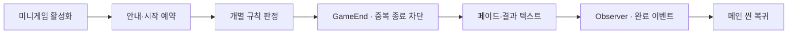

# 미니게임 공통 흐름과 대표 판정

**담당자:** 최성원 — 미니게임 진행·결과·복귀 구조 및 개별 게임 구현

## 코드



**MiniGameManager:** 안내·시작·종료·결과 표시·복귀를 공통 관리합니다. **TimingGame:** 주사기 타이밍을 판정합니다. **PathGenerator · SewingControl:** 재봉틀 경로와 경계 이탈을 판단합니다. 개별 게임은 공통 매니저의 플레이 상태를 확인하고 종료를 요청합니다.

완료 이벤트의 Observer 구조로 결과 처리와 보상 수신자를 분리합니다. 공통 매니저를 사용한다는 이유만으로 Template Method나 State 객체 패턴으로 분류하지는 않습니다.

```csharp
private bool completionSent;

// MiniGameManager: 씬 활성화 후 안내와 플레이 시작 예약
private void OnEnable()
{
    completionSent = false;
    Invoke(nameof(showInstruction), InstructionPopupTime);
    Invoke(nameof(play), GameStartTime);
}

// 종료 요청: 조작 중단 → 페이드 → 결과 텍스트 → 메인 씬 복귀
public void GameEnd(string[] texts)
{
    // 여러 판정이 같은 프레임에 종료를 요청해도 복귀 절차는 한 번만 시작한다.
    if (completionSent) return;
    completionSent = true;
    IsPlaying = false;
    StartCoroutine(Finish(texts));
}

private IEnumerator Finish(string[] texts)
{
    yield return background.DOFade(1f, endFadeTime).WaitForCompletion();
    yield return StartCoroutine(typeWrite(texts));
    // 이 이벤트는 미니게임 진행 완료를 알리며, 성적 차이는 결과 문구에 반영한다.
    OnClearEvent?.Invoke(typeId);
    SceneTransition.Instance.UnloadScene();
}

// 비활성화 시 예약과 코루틴을 정리해 다음 씬에 지연 작업을 남기지 않는다.
private void OnDisable()
{
    CancelInvoke();
    StopAllCoroutines();
    instance = null;
}
```

```csharp
// TimingGame.CheckTiming: 대상 구간에 타이밍 바가 들어왔는지 판정
private void CheckTiming()
{
    if (!GameManager.Instance.IsPlaying || !MiniGameManager.instance.IsPlaying)
        return;

    float bar = timingBar.anchoredPosition.x;
    float center = targetZone.anchoredPosition.x;
    float halfWidth = targetZone.localScale.x * targetZone.sizeDelta.x * 0.5f;
    MiniGameManager.instance.stop();
    timingBar.DOKill();
    if (bar >= center - halfWidth && bar <= center + halfWidth)
        SuccessFeedback();
    else
        FailFeedback();
}

// 원본 ResetGame의 최종 결과: 성공 수에 따라 회상 문구 선택
private void ShowTimingResult()
{
    if (savedCount == 0) MiniGameManager.instance.GameEnd(0);
    else if (savedCount == 5) MiniGameManager.instance.GameEnd(2);
    else MiniGameManager.instance.GameEnd(new[]
    {
        $"부상당한 {savedCount}명의 전우의 목숨을 구했었어.",
        $"하지만 {5 - savedCount}명은 그러지 못했지.",
        "난 그렇게 죄책감을 안고..."
    });
}
```

```csharp
// PathGenerator: 이웃 제어점 네 개로 재봉 경로의 곡선 위치 계산
private Vector2 CatmullRom(Vector2 p0, Vector2 p1, Vector2 p2, Vector2 p3, float t)
{
    // t=0은 p1, t=1은 p2이며 p0·p3가 진입·이탈 방향을 결정한다.
    float t2 = t * t, t3 = t2 * t;
    return 0.5f * ((2f * p1) + (-p0 + p2) * t
        + (2f * p0 - 5f * p1 + 4f * p2 - p3) * t2
        + (-p0 + 3f * p1 - 3f * p2 + p3) * t3);
}

// 바늘의 높이에 대응하는 중심선을 보간하고 경로 폭 안에 있는지 검사
public bool IsInTheRoad(float x, float y)
{
    if (splinePoints.Count < 2) return false;
    if (y < splinePoints[0].y || y > splinePoints[splinePoints.Count - 1].y)
        return false;

    // 점들이 y 오름차순이라는 전제에서 현재 바늘 높이를 포함하는 구간을 찾는다.
    for (int i = 0; i < splinePoints.Count - 1; ++i)
    {
        var a = splinePoints[i];
        var b = splinePoints[i + 1];
        if (y < a.y || y > b.y) continue;
        float t = Mathf.InverseLerp(a.y, b.y, y);
        float center = Mathf.Lerp(a.x, b.x, t);
        return Mathf.Abs(x - center) <= width * 0.5f;
    }
    return false;
}
```

## 생략 및 재구성한 내용

- 원본: `Assets/Scripts/MiniGameManager.cs`, `MiniGames/Syringe/TimingGame.cs`, `MiniGames/Sewing/PathGenerator.cs`·`SewingControl.cs`. 기준 커밋: `8a05e4251547a6c7cdecbcd1f97b84af051603eb`.
- 공통 매니저는 GameEnd(string[]) → typeWrite → returnToMain 흐름을 Finish 코루틴으로 합쳤습니다.
- `completionSent`의 중복 종료 방지와 `CancelInvoke`·`StopAllCoroutines`는 발췌를 안전하게 읽도록 보완한 처리이며, 기준 원본에는 없습니다. 원본 OnDisable은 머티리얼 상태와 instance를 정리합니다.
- GameEnd(int), showInstruction·play·typeWrite의 본문과 instance 설정은 원본 의존성입니다. 입력 스킵·반복 횟수·타이핑 사운드·결과 페이드는 생략했습니다.
- 이동 바·주사기·카메라 연출, 다음 라운드의 속도·구간 폭 조절은 원본 피드백 함수와 ResetGame이 담당합니다.
- 재봉틀 미니게임은 제어점 생성·손 조작·바늘 이동·LineRenderer 표시를 생략했습니다.
- 다른 미니게임들은 제외했습니다. 필드·Unity·DOTween·코루틴·씬 구성이 필요한 발췌입니다.
