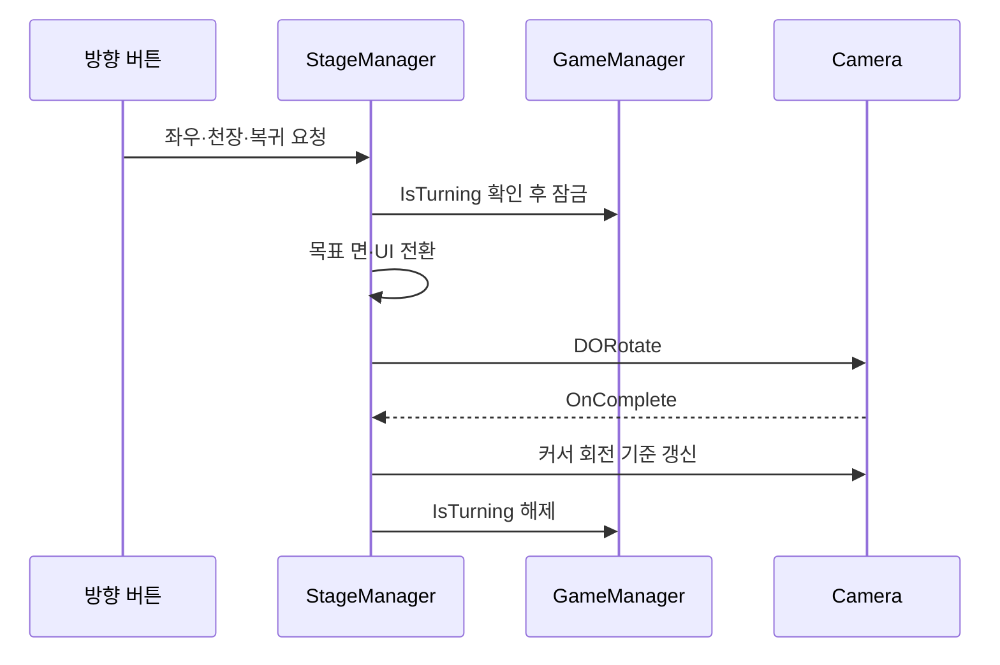

# 방 회전과 입력 상태 제어

**담당자:** 최성원 — 방 시점 전환과 카메라 연출 구현

## 코드



**StageManager:** 네 벽면과 천장 사이의 시점을 전환합니다. **GameManager:** 회전 중 중복 입력을 막는 상태를 보관합니다. **RoomPlane:** 면별 상호작용 묶음을 켜고 끄는 API를 제공합니다.

```csharp
private enum ViewChange { Left, Right, Ceiling, ReturnToSide }
private int currentPlane;
private int previousSide;

// 좌우·천장·복귀 버튼의 공통 흐름: 면 선택 → UI 전환 → 카메라 회전
private void ChangeView(ViewChange change)
{
    if (GameManager.Instance.IsTurning) return;
    if (currentPlane == 4 && change != ViewChange.ReturnToSide) return;
    if (currentPlane != 4 && change == ViewChange.ReturnToSide) return;

    GameManager.Instance.IsTurning = true;
    switch (change)
    {
        case ViewChange.Left:
            currentPlane = (currentPlane + 1) % 4;
            SceneTransition.Instance.RoomLeftTransition();
            break;
        case ViewChange.Right:
            currentPlane = (currentPlane + 3) % 4;
            SceneTransition.Instance.RoomRightTransition();
            break;
        case ViewChange.Ceiling:
            previousSide = currentPlane;
            currentPlane = 4;
            SceneTransition.Instance.RoomCeilingTransition();
            break;
        case ViewChange.ReturnToSide:
            currentPlane = previousSide;
            SceneTransition.Instance.RoomSideReturnTransition();
            break;
    }

    var rotation = currentPlane == 4
        ? new Vector3(-90f, -90f * previousSide, 0f)
        : new Vector3(0f, -90f * currentPlane, 0f);
    RotateCamera(rotation);
}

// 일시정지 중에도 연출을 진행하고, 완료 후 커서 카메라의 기준 회전 갱신
private void RotateCamera(Vector3 rotation)
{
    var camera = Camera.main;
    camera.transform.DORotate(rotation, 0.9f)
        .SetUpdate(true).SetEase(Ease.OutExpo).OnComplete(() =>
        {
            var finalRotation = Quaternion.Euler(rotation);
            camera.transform.rotation = finalRotation;
            camera.GetComponent<ViewCursorFollow>().ChangeOriginRot(finalRotation);
            GameManager.Instance.IsTurning = false;
        });
}
```

## 생략 및 재구성한 내용

- 원본: `Assets/Scripts/MainStage/StageManager.cs`, `RoomPlane.cs`, `GameManager.cs`. 기준 커밋: `8a05e4251547a6c7cdecbcd1f97b84af051603eb`.
- 좌우·천장·복귀 메서드를 enum 기반 공통 메서드로 합쳤습니다. 천장 상태에서 좌우 요청을 거부하는 검사도 추가했습니다. 카메라 연출 시간·회전 규칙·입력 잠금·기준 회전 갱신은 원본을 유지했습니다.
- RoomPlane의 활성화·비활성화 API는 존재하지만, 이 기준 커밋의 StageManager 호출은 주석 처리되어 있습니다. 실제 호출 중인 기능처럼 제시하지 않고 카메라·UI 전환만 발췌했습니다.
- 버튼 연결·싱글턴·사운드·커서 추종·SceneTransition 내부 UI 제어는 생략했습니다. Unity·DOTween과 원본 매니저 설정이 필요한 설명용 발췌이며, 취소된 Tween의 복구까지 포함한 완전한 전환 시스템은 아닙니다.
