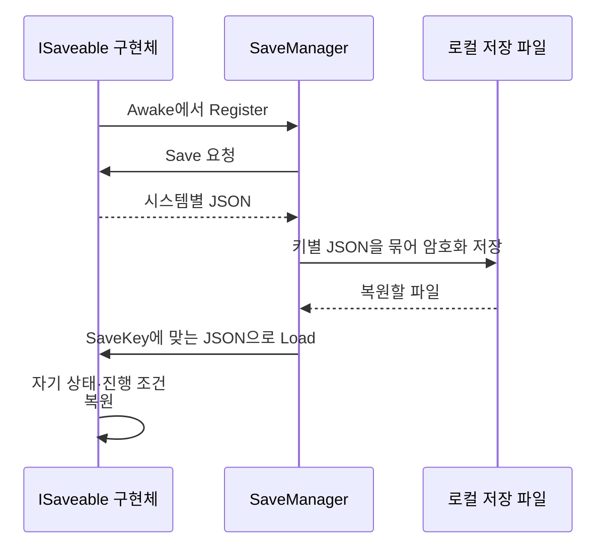

# 인터페이스 기반 진행 상태 저장·복원

**담당자:** 최성원 — 저장 대상 등록과 각 시스템의 상태 복원 구조 구현

## 코드



**ISaveable:** 시스템별 저장 키·직렬화·복원 계약입니다. **SaveManager:** 등록된 대상만 순회해 데이터를 파일로 묶습니다. **RoomInitializer:** 방 시작 시 복원을 요청합니다. **ItemManager · GameManager · NoteManager:** 각자의 상태를 저장·복원합니다. **SecureStorage:** 로컬 파일 암·복호화를 담당합니다.

```csharp
// 파일명은 ISavable.cs지만 실제 인터페이스 이름은 ISaveable이다.
public interface ISaveable
{
    // 저장 파일과 시스템을 연결하는 식별자이므로 저장·복원 시 같은 값을 쓴다.
    string SaveKey { get; }
    // 매니저는 JSON 내용을 모르며 각 시스템이 자기 상태의 변환을 책임진다.
    string Save();
    void Load(string json);
}

// SaveManager 내부: 시스템별 JSON을 저장 키로 묶는 파일 구조
[Serializable]
private class SaveEntry { public string key; public string json; }
[Serializable]
private class SaveFile { public List<SaveEntry> entries = new(); }
private readonly List<ISaveable> saveables = new();

// 각 시스템이 생명주기에 맞춰 등록·해제한다.
public void Register(ISaveable target)
{
    if (!saveables.Contains(target)) saveables.Add(target);
}
public void Unregister(ISaveable target) => saveables.Remove(target);

// 모든 대상의 직렬화 결과를 수집한 뒤 하나의 파일로 기록
public void SaveAll()
{
    if (!doSave) return;
    var file = new SaveFile();
    foreach (var target in saveables)
        file.entries.Add(new SaveEntry
            { key = target.SaveKey, json = target.Save() ?? "" });

    string plain = JsonUtility.ToJson(file);
    File.WriteAllText(savePath, SecureStorage.EncryptToBase64(plain));
}

// 키로 데이터를 찾아 전달. 개별 상태 해석은 저장 대상에게 맡긴다.
public void LoadAll()
{
    if (!doSave || !File.Exists(savePath)) return;
    string plain = SecureStorage.DecryptFromBase64(File.ReadAllText(savePath));
    if (string.IsNullOrEmpty(plain)) return;
    var file = JsonUtility.FromJson<SaveFile>(plain);
    if (file?.entries == null) return;

    var byKey = new Dictionary<string, string>();
    foreach (var entry in file.entries) byKey[entry.key] = entry.json ?? "";
    // 저장 파일에 없는 시스템도 빈 문자열을 받아 기본 상태로 초기화할 수 있다.
    foreach (var target in saveables)
        target.Load(byKey.TryGetValue(target.SaveKey, out var json) ? json : "");
}
```

```csharp
// GameManager: 자신이 저장할 내용을 ISaveable 계약으로 제공
public string SaveKey => "GameManager";
private void Awake() => SaveManager.Instance.Register(this);
private void OnDestroy() => SaveManager.Instance.Unregister(this);

// 원본 SerializableStringBoolDict로 미니게임 완료 상태 직렬화
public string Save()
{
    var data = new GameManagerData
        { gmDatas = new SerializableStringBoolDict(isGameCleared) };
    return JsonUtility.ToJson(data);
}
public void Load(string json)
{
    if (string.IsNullOrEmpty(json)) { ResetGameCleared(); return; }
    var data = JsonUtility.FromJson<GameManagerData>(json);
    isGameCleared = data.gmDatas.ToDictionary();
    // 완료 상태를 복원한 뒤 그 상태에 의존하는 진행 조건도 다시 평가한다.
    checkMiniGameAllClear();
}

// RoomInitializer.Start: 대상의 Awake 등록 이후 Start에서 복원
private void Start()
{
    SaveManager.Instance.LoadAll();
    TutorialManager.Instance.StartTutorial();
}
```

## 생략 및 재구성한 내용

- 원본: `Assets/Scripts/SaveSystem/`의 ISavable·SaveManager·RoomInitializer·SecureStorage, `GameManager.cs`. 기준 커밋: `8a05e4251547a6c7cdecbcd1f97b84af051603eb`.
- 저장 매니저는 개별 아이템이나 UI 클래스를 직접 참조하지 않고 ISaveable만 사용합니다. 예시는 GameManager 하나를 남겼고, ItemManager의 인벤토리·월드 아이템 제거 및 NoteManager의 글자 복원은 같은 계약을 따르는 별도 원본 구현입니다.
- 파일 경로는 원본 Application.persistentDataPath/save.dat를 savePath 필드로 줄였습니다. GameManager의 싱글턴·초기화와 직렬화용 딕셔너리 래퍼는 생략했습니다.
- SecureStorage의 AES-CBC 호출만 표시하고 키·IV와 암호화 본문은 제외했습니다. 
- using·클래스 선언·doSave·savePath 등 일부 필드와 파일 오류 처리·저장 삭제 UI는 생략했습니다. Unity·파일 시스템·원본 저장 모델이 필요한 설명용 발췌입니다.
