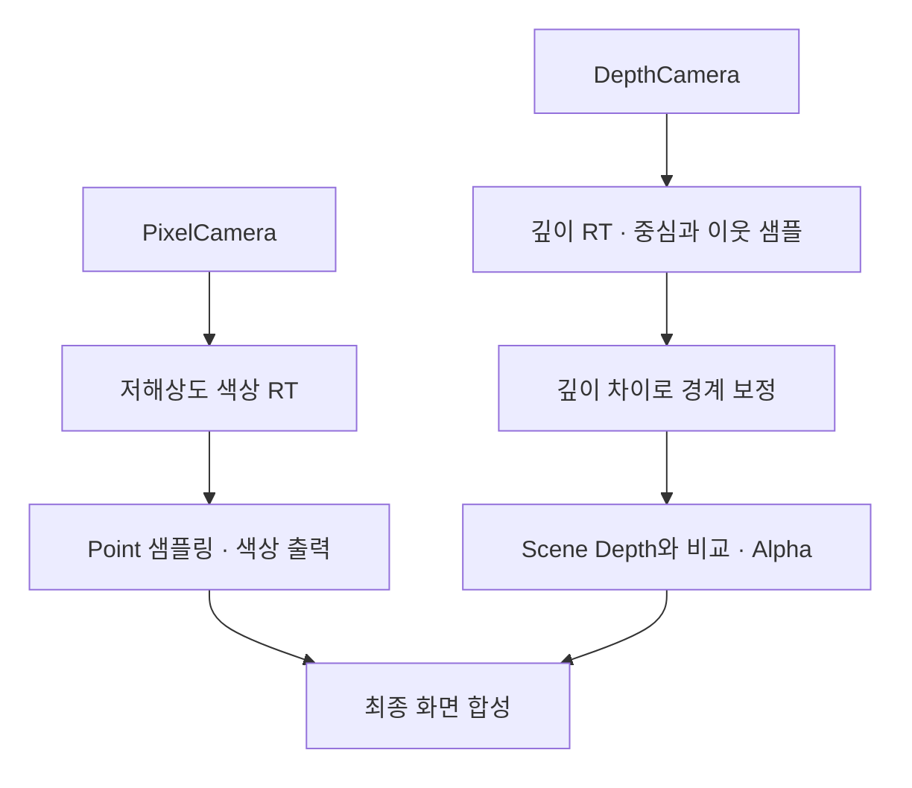
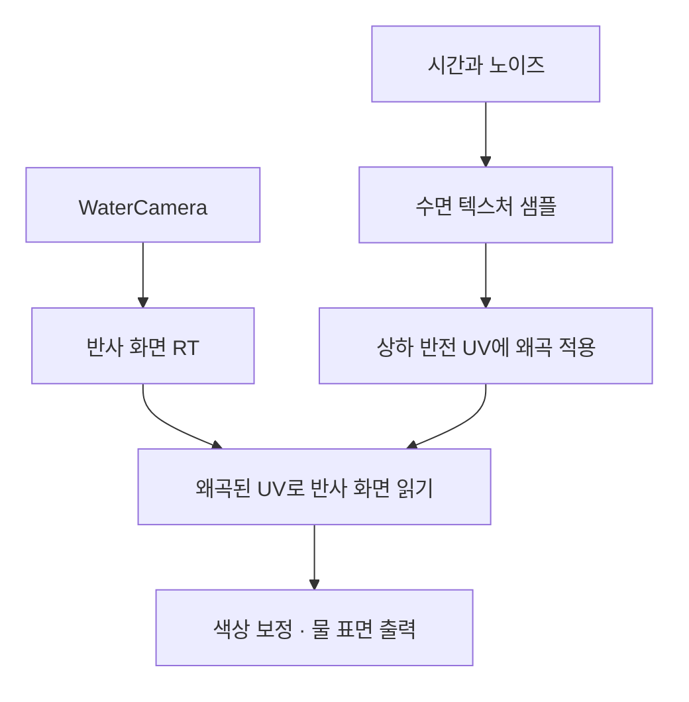

# Shader Graph 기반 픽셀 합성과 물 반사

**담당자:** 최성원 — 픽셀 렌더링·깊이 합성 및 물 반사 연출 구현

## 코드

**PixelEffect.shadergraph:** 픽셀 카메라의 저해상도 색상과 깊이를 합성합니다. **Water.shadergraph:** WaterCamera의 화면을 뒤집어 읽고 수면 텍스처로 UV를 왜곡합니다. 아래 코드는 원본 그래프 연결을 HLSL 형태로 재구성한 **설명용 의사코드**이며, 원본 HLSL 파일이나 그대로 실행하는 셰이더가 아닙니다.

**픽셀 렌더링과 가림 처리**



```yaml
# PixelTexture.renderTexture의 관련 설정만 발췌. RT는 씬별로 별도 사용한다.
m_Width: 352
m_Height: 198
m_AntiAliasing: 1
m_FilterMode: 0 # Point: 저해상도 픽셀 경계를 보간하지 않음
```

```hlsl
// SampleDepth와 SceneDepth는 서로 다른 카메라의 깊이 입력을 나타낸다.
float2 texel = 1.0 / DepthTextureSize;
float center = SampleDepth(uv);
float4 neighbors = float4(
    SampleDepth(uv + float2(texel.x, 0)),
    SampleDepth(uv - float2(texel.x, 0)),
    SampleDepth(uv + float2(0, texel.y)),
    SampleDepth(uv - float2(0, texel.y)));

// 원본 Subtract / Clamp / Add / Saturate / Multiply / Power 연결의 요약
float edge = saturate(dot(saturate(neighbors - center), float4(1, 1, 1, 1)));
float maxNeighbor = max(max(neighbors.x, neighbors.y), max(neighbors.z, neighbors.w));
float correction = clamp(pow(edge * 300.0, 0.6), 0.0, maxNeighbor);
float alpha = saturate(ceil(center + correction - SceneDepth(uv)));
float3 color = SamplePixelColor(uv).rgb;
```

**물 반사와 수면 왜곡**



```hlsl
// 원본 Time / Gradient Noise / Tiling And Offset의 연결을 풀어 쓴 의사코드
float noise = GradientNoise(uv, _NoiseStrength);
float2 movingUV = uv * _WaterMoveVector2 + noise + time * _WaterSpeed;
float water = SampleWaterTexture(movingUV).r;

// RefractionStrength를 0~1에서 0~0.02로 Remap한다. Clamp를 추가하지 않는다.
float distortion = (_RefractionStrength * 0.02) * water;
float2 reflectedUV = uv * float2(1, -1) + float2(distortion, 1);
float3 color = SampleReflectionRT(reflectedUV).rgb * _Color.rgb;
```

```yaml
# WaterMaterial.mat의 실제 사용값 발췌. Shader Graph 기본값과 구분한다.
_NoiseStrength: 1.45
_RefractionStrength: 2.41
_WaterSpeed: 0.08
_WaterMoveVector2: {x: 1, y: -1}
```

## 생략 및 재구성한 내용

- 원본: `Assets/Shaders/Pixel/PixelEffect.shadergraph`, `Assets/Shaders/Water.shadergraph`, `Assets/PixelTextures/PixelTexture.renderTexture`, `Assets/Sprites/Ending/WaterMaterial.mat`. 기준 커밋: `8a05e4251547a6c7cdecbcd1f97b84af051603eb`.
- MainScene의 PixelCamera·DepthCamera와 Ending의 WaterCamera가 각 RT를 출력하는 연결도 확인했습니다. RT 경로·GUID·해상도는 씬마다 다르며, 352×198은 위 PixelTexture 에셋의 예시입니다.
- Shader Graph는 여러 JSON 오브젝트로 저장됩니다. 슬롯 ID·직렬화 데이터 대신 실제 연결의 수식을 재구성했고, 중복된 중심 깊이 샘플은 한 변수로 합쳤습니다. 0.6 등 부동소수 기본값은 읽기 쉽게 반올림했습니다.
- SampleDepth·SceneDepth·SamplePixelColor·SampleWaterTexture·SampleReflectionRT·GradientNoise·time은 원본 노드의 입력/출력을 나타내는 설명용 이름입니다. 카메라별 깊이 설정·UV 입력·샘플러·URP 출력 슬롯·머티리얼 연결 없이는 실행되지 않습니다.
- 반사는 WaterCamera의 RT를 UV 반전·왜곡으로 표시하는 방식입니다. 카메라 위치·출력 대상·레이어 설정은 씬 의존성으로 생략했습니다.
- 부가 연출인 디졸브·TV 노이즈·CRT·툰 셰이더는 이번 대표 샘플에서 제외했습니다. 이 문서는 비주얼 연출 기여이며 삭제된 최적화 사례를 복원하지 않습니다.
