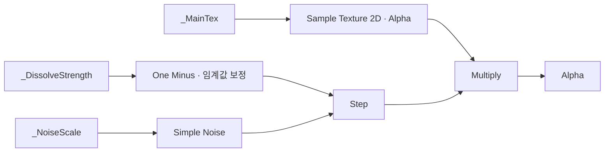

# Shader Graph 기반 디졸브·TV 노이즈

**담당자:** 최성원 — Shader Graph 비주얼 연출 구현

## 코드

**Dissolve.shadergraph:** 노이즈와 임계값으로 표시 영역과 경계 색을 만듭니다. **TVnoise.shadergraph:** 시간에 따른 UV 이동과 노이즈를 연결합니다. C# 구현이 아닌 그래프 에셋이므로 실제 노드 연결과 프로퍼티를 보여줍니다.



```json
[
  {
    "asset": "Assets/Shaders/Dissolve.shadergraph",
    "properties": [
      { "reference": "_DissolveStrength", "default": 0.5899999737739563 },
      { "reference": "_NoiseScale", "default": 25 },
      { "reference": "_EmissionColor", "default": { "r": 0, "g": 0, "b": 0, "a": 0 } },
      { "reference": "_MainTex", "type": "Texture2D" }
    ]
  },
  {
    "asset": "Assets/Shaders/TVnoise.shadergraph",
    "connections": [
      ["Time", "Multiply", "Tiling And Offset.Offset"],
      ["Simple Noise", "Tiling And Offset.UV"],
      ["Tiling And Offset", "Simple Noise", "BaseColor"]
    ]
  }
]
```

## 생략 및 재구성한 내용

- 원본: Assets/Shaders/Dissolve.shadergraph, TVnoise.shadergraph. 기준 커밋: `8a05e4251547a6c7cdecbcd1f97b84af051603eb`.
- 원본은 여러 JSON 오브젝트로 직렬화된 Shader Graph입니다. 위 JSON은 프로퍼티와 연결만 읽기 쉽게 요약한 목록이며 원본 스키마나 실행 가능한 셰이더 코드가 아닙니다.
- 구조도는 Dissolve의 Alpha 경로를 중심으로 단순화했습니다. One Minus 이후 Add의 오프셋, 경계 색 계산용 별도 Step·Subtract·Multiply·Add 분기, 출력 타깃·슬롯 ID를 생략했습니다.
- TVnoise의 Time→Multiply→Offset 연결은 확인되지만, 이동 속도는 그래프의 Vector 2 입력값과 연결된 머티리얼 설정에 따라 달라집니다. 이 에셋의 기본값만으로 실제 화면에서 이동한다고 단정하지 않습니다.
- 시퀀스화는 포폴 최적화 항목에서 제거됐으며 이 문서는 비주얼 연출 기여만 설명합니다.
